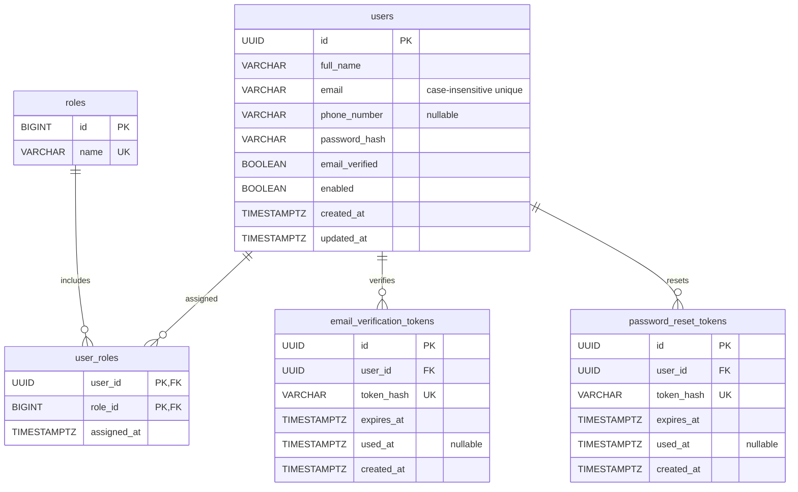

# Database schema

Pashe uses PostgreSQL 17. Flyway manages schema changes under
`backend/src/main/resources/db/migration/`; applied migrations are immutable.
Application code is expected to generate UUIDs for user and token IDs.

## Tables

### Care Circle and self-SOS

`V20261118000100` adds `care_circle_memberships` and `care_circle_events` for
two-party consent. A recipient/invitee pair has at most one pending or active
relationship. History records the acting user and transition time.

`V20261118000500` adds `self_sos_requests` (durable countdown, idempotency key and
linked incident), `self_sos_incidents` (recipient, open/resolved timestamps and
optional pickup address) and `self_sos_locations` (one latest point per user).
Partial unique indexes allow only one countdown and one open incident per recipient.
User references are restrictive so care history cannot be silently erased.

The presentation launcher uses the separate `pashe_sos_demo` schema. See the
[presentation guide](care-circle-sos-demo.md) for setup and API details.

### `users`

Stores shared application identity and password hashes. `email` is unique
without regard to case through a unique index on `lower(email)`. User deletion
cascades to their role assignments and authentication tokens. `updated_at` is
initialized on insert; application code must update it when changing a user.

### `roles` and `user_roles`

`roles` contains the role catalog. Migration V4 seeds `USER`, `ADMIN`,
`AMBULANCE_OPERATOR`, and `PHARMACY_STAFF`. `user_roles` implements the
many-to-many assignment with a `(user_id, role_id)` primary key, preventing
duplicate assignments. Deleting a user cascades to assignments; referenced
roles cannot be deleted while assigned.

### `email_verification_tokens` and `password_reset_tokens`

These tables store token hashes only, never raw tokens. Token hashes are unique
within their respective table. Each token references one user and is deleted
when that user is deleted. `user_id` is indexed for per-user lookups.

## Column definitions

| Table | Column | Type | Constraints |
| --- | --- | --- | --- |
| `users` | `id` | UUID | Primary key |
| `users` | `full_name` | VARCHAR(100) | Not null; cannot be blank |
| `users` | `email` | VARCHAR(255) | Not null; cannot be blank; unique by `lower(email)` |
| `users` | `phone_number` | VARCHAR(20) | Nullable |
| `users` | `password_hash` | VARCHAR(255) | Not null; cannot be blank |
| `users` | `email_verified` | BOOLEAN | Not null; defaults to false |
| `users` | `enabled` | BOOLEAN | Not null; defaults to true |
| `users` | `created_at` | TIMESTAMPTZ | Not null; defaults to current timestamp |
| `users` | `updated_at` | TIMESTAMPTZ | Not null; defaults to current timestamp |
| `roles` | `id` | BIGINT | Generated-always identity primary key |
| `roles` | `name` | VARCHAR(50) | Not null; unique |
| `user_roles` | `user_id` | UUID | Not null; FK to `users.id`, cascade on user deletion |
| `user_roles` | `role_id` | BIGINT | Not null; FK to `roles.id`, restrict role deletion |
| `user_roles` | `assigned_at` | TIMESTAMPTZ | Not null; defaults to current timestamp |
| `email_verification_tokens` | `id` | UUID | Primary key |
| `email_verification_tokens` | `user_id` | UUID | Not null; FK to `users.id`, cascade on user deletion |
| `email_verification_tokens` | `token_hash` | VARCHAR(255) | Not null; unique |
| `email_verification_tokens` | `expires_at` | TIMESTAMPTZ | Not null |
| `email_verification_tokens` | `used_at` | TIMESTAMPTZ | Nullable |
| `email_verification_tokens` | `created_at` | TIMESTAMPTZ | Not null; defaults to current timestamp |
| `password_reset_tokens` | `id` | UUID | Primary key |
| `password_reset_tokens` | `user_id` | UUID | Not null; FK to `users.id`, cascade on user deletion |
| `password_reset_tokens` | `token_hash` | VARCHAR(255) | Not null; unique |
| `password_reset_tokens` | `expires_at` | TIMESTAMPTZ | Not null |
| `password_reset_tokens` | `used_at` | TIMESTAMPTZ | Nullable |
| `password_reset_tokens` | `created_at` | TIMESTAMPTZ | Not null; defaults to current timestamp |

`user_roles` uses `(user_id, role_id)` as its composite primary key.

## ER diagram



## Migration sequence

| Version | Migration | Contents |
| --- | --- | --- |
| V1 | `V1__initial_setup.sql` | Preserved initial placeholder migration |
| V2 | `V2__create_users_and_roles.sql` | Users, roles, role assignments |
| V3 | `V3__create_authentication_tokens.sql` | Email verification and password reset tokens |
| V4 | `V4__seed_default_roles.sql` | Default role records |

No Guardian SOS, Care Circle, ambulance, blood donation, Health Passport, or
medicine tables are part of this schema.

## Validation status

The migrations and configuration were reviewed statically. Docker and
PostgreSQL client tools are installed, but the Pashe database container was
not started during the latest configuration change. Live migration and schema
validation therefore remain pending. On this Windows host, a local PostgreSQL
service uses host port `5432`; Compose publishes the container on
`DB_HOST_PORT` (default `5433`). After setting a private `DB_PASSWORD` in
`.env`, follow the database startup steps in the root README, then check:

```powershell
docker compose exec postgres psql -U pashe -d pashe_db -c "\dt"
docker compose exec postgres psql -U pashe -d pashe_db -c "SELECT name FROM roles ORDER BY name"
docker compose exec postgres psql -U pashe -d pashe_db -c "SELECT installed_rank, version, success FROM flyway_schema_history ORDER BY installed_rank"
```

Confirm case-insensitive email uniqueness by attempting to insert two users
with the same email in different letter cases; the second insert must fail.
Confirm duplicate role assignment rejection by inserting the same `(user_id,
role_id)` twice; the second insert must fail. Use throwaway records inside a
transaction and roll back validation inserts. Confirm persistence by stopping
and restarting the container without removing `pashe_postgres_data`.
